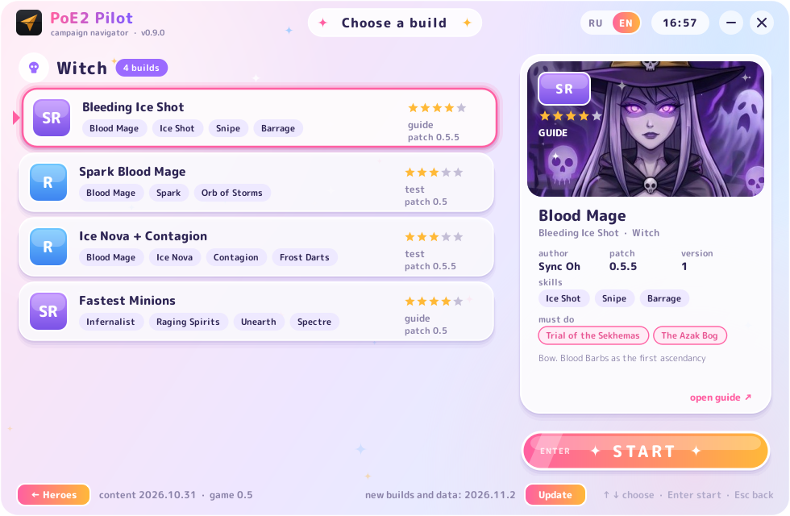
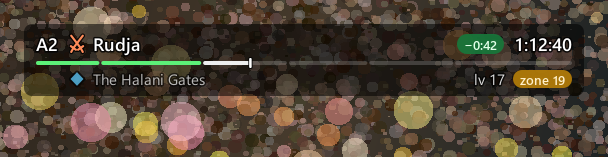

# PoE2 Pilot

**English** · [Русский](README.ru.md)

**Your Path of Exile 2 campaign navigator.** An overlay on top of the game that shows the next route step, a split timer against your best run, and a level-by-level build plan: which passives to take, which gems to socket, what to wear.


## What it looks like
- **Choose your hero.** The app opens on eight classes as gacha-style cards, each an anime portrait in its own scene. One shortcut for everything, no shortcut per build.
- **Choose a build.** Click a hero to see their builds by rarity: SSR is a verified guide, SR follows the author's guide, R is a test build. The card on the right shows the skills, must-do trials and a link to the guide. Then press **START**.



- **HUD.** One bar at the top: where you are, where to go next, the time and how far you are from your PB. Level hints pop up for 3 seconds and fade.
- **Gems (`Alt+G`) and tree (`Alt+T`).** What to socket and what to take at exactly this level. Click a name to copy it for the in-game search.
- **Change build** from the tray: right-click the icon → "Change build…".
- **Language.** English or Russian: the RU / EN switch at the top of the start window. By default it follows your Windows language.



## Safe for your account
The app only reads the game log, `Client.txt`. It never presses keys for you, never reads the game's memory and never touches its files.
Run the game in **Windowed Fullscreen** (borderless): in exclusive fullscreen the overlay can't be seen.

## Install
1. Download `PoE2Pilot-vX.Y.Z.zip` from [Releases](../../releases/latest) and unpack it anywhere.
2. Run `PoE2Pilot.exe`. Keep the `_internal` folder next to it.
3. Choose a hero, then a build, press START and go into the game.

Windows may say "Windows protected your PC": the exe isn't signed. Click "More info" → "Run anyway".
If the game runs as administrator, run PoE2 Pilot the same way, or the hotkeys won't reach the game.
Only one copy runs at a time. If `Client.txt` isn't found, the app asks you to point at it. The previous run's log is kept as `pilot.prev.log`.

## Hotkeys
| Key | Action |
|---|---|
| `Alt+Q` (hold) | details: next steps, gems, gear |
| `Alt+G` | gems window |
| `Alt+T` | passive tree |
| `Alt+]` / `Alt+[` | route step forward / back |
| `Alt+P` | pause the timer |
| `Alt+R` | reset the run |
| `Alt+E` | drag and resize the HUD; press again to save |
| `Alt+H` | hide / show |

A hotkeys cheat sheet shows on the first start and opens from the tray ("Hotkeys…"). Settings: `%APPDATA%\poe2-pilot\config.json`. Runs and PBs: `%APPDATA%\poe2-pilot\runs\`.

## Builds and updates
Builds live in [`builds/`](builds): authors and links in [`builds/SOURCES.md`](builds/SOURCES.md), the start window's cards in [`builds/catalog.json`](builds/catalog.json).

**Updates arrive by themselves.** On start the app asks GitHub for new builds and game data (tree, gems, route). If there are any, an "Update" button appears in the footer. Only changed files are downloaded, each checked by sha256, into `%APPDATA%\poe2-pilot\content`. The app itself isn't updated this way: a new exe comes out on the Releases page, and the start window tells you about it.

Class art lives in `data/ui/classes/<class>.jpg`: square, face in the upper half. To replace a picture, drop your own `.jpg` or `.png` with the same name and run `python tools/make_content_manifest.py`. The window font is M PLUS Rounded 1c (OFL), in `assets/fonts`.

Translations: texts in the data carry an English twin with the `_en` suffix (`short_en` and `detail_en` in the route, `gear_en` and `zones_en` in build hints, `note_en` in the catalog). UI strings are in `src/pilot/i18n_en.py`; a test won't let a translation be forgotten.

Build rarity:
- **SSR ★★★★★**: the author's verified guide;
- **SR ★★★★**: the author's file or text;
- **R ★★★**: tree or plan put together by us, untested in game;
- **OLD**: made for an older patch, waiting for an update.

### Getting ready for 1.0
When the patch lands, builds are updated from the ones we have:
1. Fresh tree and gem data from Path of Building: `python -I tools/planner/extract.py --pob vendor/pob2 --out data/planner`.
2. Set `"game": "1.0"` in `builds/catalog.json`. Every old build shows as OLD at once.
3. Update a build's file and raise its `rev` and `patch`. If the route changed, update `data/routes/` and `"route"` in the catalog.
4. `python tools/make_content_manifest.py`, then commit and push to `main`. Players get the update on their next start.
5. If the new data needs a newer app (a new build format, say), use `--min-app 1.0.0`. Older versions won't download it and will point to the new release instead.

## Development
```
pip install -e .[dev]
python -m pilot.app                       # hero and build choice, then the overlay
python -m pilot.app --build grenades_gemling_0_5_5.build   # straight into a build
python -m pilot.app --replay tests/fixtures/campaign_ru.log --speed 400   # demo on a recorded run
python -m pilot.planner builds/grenades_gemling_0_5_5.build              # print a build's plan
python -m pytest
```
Build the exe: `pip install pyinstaller`, then `python packaging/build_exe.py --windowed`. The result lands in `dist/PoE2Pilot/`.
Release: raise `__version__` in `src/pilot/__init__.py` and push a `vX.Y.Z` tag. GitHub Actions builds the zip and puts it on Releases.

Docs (in Russian): [`docs/ARCHITECTURE.md`](docs/ARCHITECTURE.md) · [`docs/UX.md`](docs/UX.md) · [`docs/ROUTE_SCHEMA.md`](docs/ROUTE_SCHEMA.md) · [`docs/TESTING.md`](docs/TESTING.md)

## License
The code is [MIT](LICENSE). Builds belong to their authors: see `builds/SOURCES.md`. Tree and gem data come from [Path of Building Community (PoE2)](https://github.com/PathOfBuildingCommunity/PathOfBuilding-PoE2), MIT, see `data/planner/ATTRIBUTION.md`.
This project is not affiliated with or endorsed by Grinding Gear Games. Path of Exile is a trademark of Grinding Gear Games.
