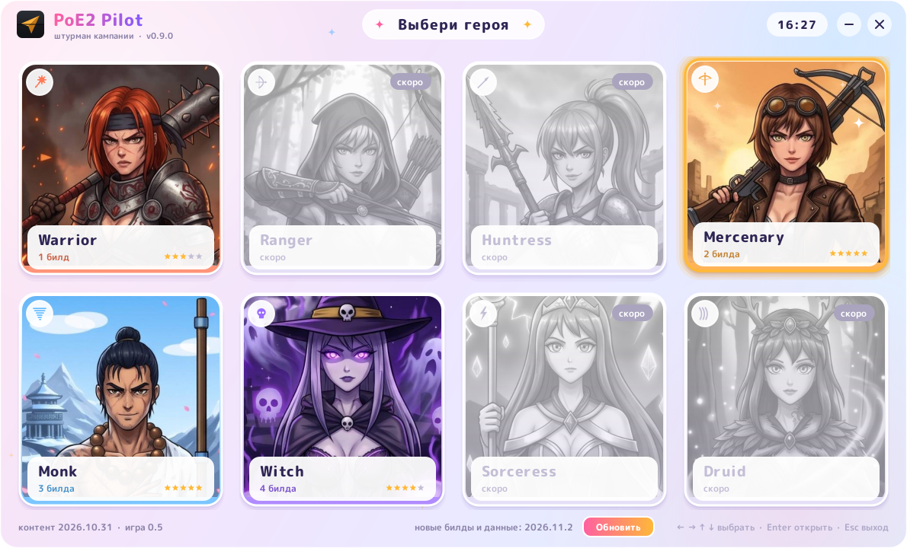
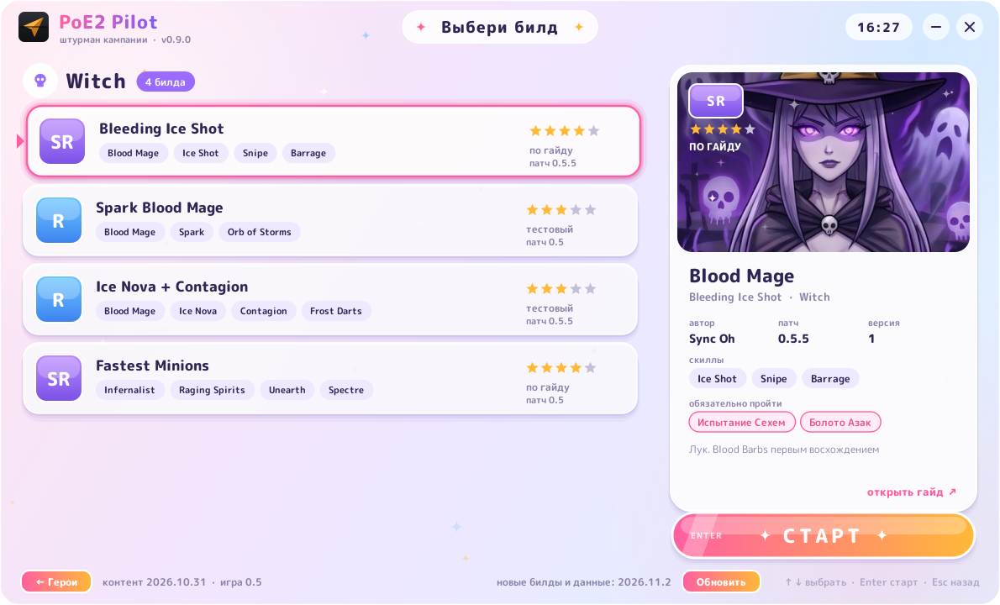
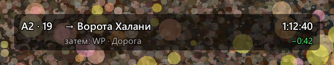

# PoE2 Pilot

**Штурман кампании Path of Exile 2.** Оверлей поверх игры показывает следующий шаг маршрута, таймер со сплитами против твоего лучшего забега и план билда по уровням: какие пассивки брать, какие гемы вставлять, что надеть.

*Campaign overlay for Path of Exile 2: route step, split timer vs your PB, per-level build plan. UI in Russian.*



## Как это выглядит
- **Выбор героя.** При запуске открывается окно с восемью классами в виде гача-карточек: у каждого класса аниме-портрет на фоне своей сцены. Ярлык один, отдельный на каждый билд не нужен.
- **Выбор билда.** Жмёшь на героя, и открывается список его билдов с редкостью: SSR — проверенный гайд, SR — по гайду автора, R — тестовый. Справа карточка билда: скиллы, обязательные испытания, ссылка на гайд. Дальше жмёшь **СТАРТ**.



- **HUD.** Одна полоска сверху: где ты, куда дальше, время и отставание от PB. Подсказки уровня всплывают на 3 секунды и исчезают.
- **Гемы (`Alt+G`) и дерево (`Alt+T`).** Что вставить и что взять именно на этом уровне. Клик по названию копирует его для поиска в игре.
- **Сменить билд** можно из трея: правый клик по значку → «Сменить билд…».



## Безопасно для аккаунта
Программа читает только лог игры `Client.txt`. Она не нажимает клавиши за тебя, не читает память игры и не изменяет её файлы.
Игра должна быть в режиме **оконный полноэкранный** (borderless): в эксклюзивном полноэкранном режиме оверлей не виден.

## Установка
1. Скачай `PoE2Pilot-vX.Y.Z.zip` со страницы [Releases](../../releases/latest) и распакуй куда угодно.
2. Запусти `PoE2Pilot.exe`. Папку `_internal` держи рядом с ним.
3. Выбери героя, потом билд, нажми «СТАРТ» и зайди в игру.

## Хоткеи
| Клавиша | Действие |
|---|---|
| `Alt+Q` (держать) | детали: следующие шаги, гемы, снаряжение |
| `Alt+G` | окно гемов |
| `Alt+T` | дерево пассивок |
| `Alt+]` / `Alt+[` | шаг маршрута вперёд / назад |
| `Alt+P` | пауза таймера |
| `Alt+R` | сброс забега |
| `Alt+E` | перетащить и масштабировать HUD, повторное нажатие сохраняет |
| `Alt+H` | скрыть / показать |

Настройки: `%APPDATA%\poe2-pilot\config.json`. Забеги и PB: `%APPDATA%\poe2-pilot\runs\`.

## Билды и обновления
Билды лежат в [`builds/`](builds): список с авторами и ссылками в [`builds/SOURCES.md`](builds/SOURCES.md), карточки окна выбора в [`builds/catalog.json`](builds/catalog.json).

**Обновления приходят сами.** При запуске окно выбора спрашивает у GitHub, нет ли новых билдов и игровых данных: дерева, гемов, маршрута. Если есть, в футере появится кнопка «Обновить». Скачиваются только изменённые файлы, каждый проверяется по sha256 и кладётся в `%APPDATA%\poe2-pilot\content`. Программа при этом не обновляется: новая версия exe выходит на странице Releases, и окно выбора подскажет, что она есть.

Арты классов лежат в `data/ui/classes/<класс>.jpg`: квадрат, лицо в верхней половине. Чтобы заменить картинку, положи свою `.jpg` или `.png` с тем же именем и запусти `python tools/make_content_manifest.py`. Шрифт окна: M PLUS Rounded 1c (OFL), лежит в `assets/fonts`.

Редкость билда:
- **SSR ★★★★★**: проверенный гайд автора;
- **SR ★★★★**: файл или текст автора;
- **R ★★★**: дерево или план собраны нами и в игре не проверены;
- **OLD**: билд сделан под старый патч и ждёт обновления.

### К релизу 1.0
Когда выйдет патч, билды обновляются на базе уже имеющихся:
1. Свежие данные дерева и гемов из Path of Building: `python -I tools/planner/extract.py --pob vendor/pob2 --out data/planner`.
2. В `builds/catalog.json` поменять `"game": "1.0"`. Все старые билды сразу покажутся как OLD.
3. Обновить файл билда, поднять у него `rev` и `patch`. Если менялся маршрут, обновить `data/routes/` и `"route"` в каталоге.
4. `python tools/make_content_manifest.py`, затем коммит и push в `main`. Игроки получат обновление при следующем запуске.
5. Если новым данным нужна новая программа (например, другой формат билда), используй `--min-app 1.0.0`. Старые версии такое обновление не скачают и предложат новую.

## Разработка
```
pip install -e .[dev]
python -m pilot.app                       # выбор героя и билда, затем оверлей
python -m pilot.app --build grenades_gemling_0_5_5.build   # сразу с билдом
python -m pilot.app --replay tests/fixtures/campaign_ru.log --speed 400   # демо на записанном забеге
python -m pilot.planner builds/grenades_gemling_0_5_5.build              # план билда в консоль
python -m pytest
```
Сборка exe: `pip install pyinstaller`, затем `python packaging/build_exe.py --windowed`. Результат появится в `dist/PoE2Pilot/`.
Релиз: подними `__version__` в `src/pilot/__init__.py` и запушь тег `vX.Y.Z`. GitHub Actions соберёт zip и выложит его на Releases.

Документация: [`docs/ARCHITECTURE.md`](docs/ARCHITECTURE.md) · [`docs/UX.md`](docs/UX.md) · [`docs/ROUTE_SCHEMA.md`](docs/ROUTE_SCHEMA.md) · [`docs/TESTING.md`](docs/TESTING.md)

## Лицензия
Код распространяется под [MIT](LICENSE). Билды принадлежат их авторам: см. `builds/SOURCES.md`. Данные дерева и гемов взяты из [Path of Building Community (PoE2)](https://github.com/PathOfBuildingCommunity/PathOfBuilding-PoE2), MIT, см. `data/planner/ATTRIBUTION.md`.
Проект не связан с Grinding Gear Games и не одобрен ею. Path of Exile является товарным знаком Grinding Gear Games.
